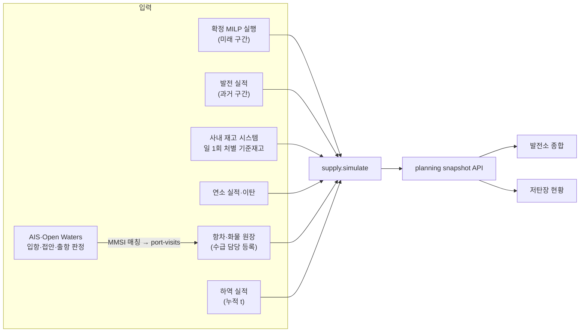

# 저탄장 시뮬레이션 데이터 통합 검토 · 2026-11-02

저탄장 시뮬레이션에 다음 세 입력을 연결하는 방안을 검토한다.

1. 발전소 종합의 예측 발전량(API)
2. 저탄장 재고 DB
3. 선박현황의 도착예정 선박 입고

기준은 main `5fb1758`(PR #15 병합 시점)이다. 이 문서는 현황 조사와 제안이며 코드·계약을 바꾸지 않는다. 결정이 필요한 항목은 [6절](#6-결정-필요-사항)에 모았다. 코드 위치는 [부록](#부록-확인한-코드-위치)에 있다.

## 1. 결론

- **계산 엔진은 이미 있다.** `backend/src/midterm/supply.py`의 `simulate()`가 시간별 발전계획, 처별 기준재고·재고 lot, 하역 원장, 이탄, 입항 관측을 받아 처(g14·g58·g910)별 재고를 1시간 단위로 계산한다. 화면은 `GET /api/planning/runs/{run_id}/snapshot` 한 번으로 발전량과 재고 전망을 함께 받는다.
- **막힌 곳은 입력이다.**
  1. 실제 저탄장 재고를 받아 오는 연계가 없다. 저장소 DB의 기준재고는 0건이고 공유 seed에만 가상 값이 있다.
  2. 선박현황(AIS)과 화물 원장이 끊겨 있다. AIS에는 화물량·탄종이 없고, ETA·흘수도 저장하지 않는다.
  3. 발전계획에 '확정' 표시가 없어 최신 계획이나 기간을 덮는 첫 계획을 쓴다. 과거 실적과 미래 계획을 잇지 않는다.
- **부두 배정과 체선 포함 전망은 구현돼 있으나 원격에 없다.** `codex/fuel-berth-simulation` 브랜치의 로컬 커밋 `ab39811`(2026-10-13, 51개 파일)이다. PR #15 이전 main(`efd3c43`)에서 갈라졌다.

## 2. 원천별 현황

### 2.1 발전소 종합 예측 발전량

| 구분 | 내용 |
|---|---|
| 있는 것 | `GET /api/planning/runs/{run_id}/snapshot?start=&horizon=` (기간 7·30·60·90일, `schema_version` 1). 일별·호기별(`dj-1`~`dj-10`) 발전량, 연료 톤, 월별 합계, 정비, 모델값, 재고 전망(`inventory`), 선박을 한 응답에 담는다. 저장된 MILP 결과를 읽기만 하고 다시 풀지 않는다. 저탄장 화면이 이미 사용한다. |
| 계획 선택 | React는 실행 목록의 첫 행(`use-planning.ts`의 `rows[0]`)을 기본으로 고른다. `GET /api/supply/dashboard`는 `plan_key`가 없으면 조회일을 덮는 첫 계획(DB 배치 최신순, 그다음 MILP 실행)을 쓴다. 승인·확정 표시는 없다. |
| 실적 | `POST /api/supply/plans`로 `observed_generation`(완료된 1시간 구간의 평균 MW)을 저장할 수 있다. 엔진은 배치 하나나 MILP 실행 하나만 계획으로 쓰므로 과거 실적과 미래 계획을 잇지 않는다. |
| 인증 | 사용자 세션만 있다(최대 12시간, 1시간 무활동 시 만료). 서버 간 호출용 서비스 계정·API 키는 없다. |
| 기타 | `/api/runs/{id}/hourly`·`/excel`은 디스크의 `summary.json`을 읽으므로 DB에만 저장된 실행은 조회하지 못한다. 연료 톤 산정이 두 방식이다. 스냅샷 `daily.fuel_tonnes`는 고정 기준 발열량을, 재고 전망은 처별 혼합 발열량을 쓴다. |

### 2.2 저탄장 재고

| 구분 | 내용 |
|---|---|
| 있는 것 | 원장 테이블 `supply_baselines`(처별 기준재고 t, 발열량, 수분·회분·황분), `supply_stock_lots`, `supply_transfers`(이탄). 등록은 `POST /api/supply/baselines`(관리자)와 `POST /api/supply/transfers`. 기준시각이 72시간을 넘으면 오래된 값으로 표시한다(`baseline_stale_hours`). |
| 자료 | `backend/data/planning.sqlite3`: 기준재고·선박·하역·연소 실적 0건. `backend/seeds/fuel-integration-2027.sqlite3`: 가상 기준재고 3건(g14 14만 t, g58 20만 t, g910 30만 t, `is_assumption: true`), 재고 lot 6건, 선박 1척. ZGX 운영 DB의 등록 상태는 이 검토에서 확인하지 않았다. |
| 빈 곳 | 실제 재고 시스템에서 받아 오는 수집기가 없다. Pile 단위 원장도 없다. 화면의 Pile·센서는 합성 표본이고 `/api/v1/stockpiles/sensors`는 서버에 구현되지 않았다. 연소 실적 `fuel_actual_daily`는 수급 엔진이 읽지 않는다. |

### 2.3 선박현황 도착예정 선박

| 구분 | 내용 |
|---|---|
| AIS | ZGX가 AISstream을 상시 수집하고 Open Waters로 보조한다. 저장 항목은 MMSI, IMO, 위치·SOG·COG, 항해상태, 선명, 선종, 목적지 문자열이다. 당진행 판정은 목적지 문자열(`KRTJI`, DANGJIN, TANGJIN, 당진)로만 하고 후보를 72시간 보관한다. ETA·흘수·선박 크기는 저장하지 않는다. 실제 선박 ETA는 브라우저가 SOG와 잔여거리로 계산하며 서버에 남지 않는다. |
| 화물 원장 | `supply_vessels`(선명, 화물 t, 입고 발열량, 도착시각, MMSI, IMO, 부두, 탄종, `run_id`), `supply_unload_points`(누적 하역 실적), `supply_port_visits`(입항·접안·출항 관측). `POST /api/supply/port-visits`는 `source`+`event_id`로 중복 등록을 막는다. |
| 빈 곳 | AIS 관측을 원장 화물에 MMSI로 잇는 코드가 없다. `POST /api/supply/port-visits`를 호출하는 화면·수집기가 없다. 계정별 선박추적 항차(화물량 등 가정)를 공용 원장으로 옮기는 경로가 main에 없다. 저탄장 화면의 `GET /api/v1/vessels`는 서버에 구현되지 않아 더미 표본을 쓴다. |
| 규칙 | 데이터 사전: AIS 위치만으로 화물(Cargo)을 만들거나 원장에 자동 등록하지 않는다. AIS 목적지 문자열은 확정 목적 발전소가 아니다. |

### 2.4 부두·체선 (미반영 브랜치)

`codex/fuel-berth-simulation`(`ab39811`)에 다음이 구현돼 있다.

- 테이블: `supply_berths`, `supply_berth_assignments`, `supply_simulation_runs`, `supply_simulation_daily`
- API: 화물 등록 `POST /api/supply/shipments`, 부두 `GET·PUT /api/supply/berths`, 추천 `GET /api/supply/berth-recommendations`, 배정 확정 `POST /api/supply/berth-assignments`(`expected_version` 필수), 비교 실행 `POST·GET /api/supply/simulations`
- 전망 옵션: `assigned`(확정 배정만 반영), `include_waiting`(미배정 화물을 ETA 순으로 가상 접안·하역)
- 저장된 입력 스냅샷으로 다시 계산(`replay`)하므로 이후 DB가 바뀌어도 당시 결과를 재현한다
- 계정별 선박추적 항차 중 당진행 항차를 공용 원장으로 불러온다
- AIS 입항 자동 판정은 없다

## 3. 기준이 서로 다른 부분

| 항목 | 백엔드 엔진 (DB 전망) | 저탄장 합성 엔진 (TS) | 제안 |
|---|---|---|---|
| 하루 경계 | KST 00시~24시 | KST 09시~다음 날 09시 | 하나로 통일한다. 현장 마감이 09시면 엔진 일별 집계에 경계 옵션을 추가한다. |
| 재고일수 기준 | 위험 7일 미만, 정상 15일 이상 (`supply.py` 기본값, `PUT /api/supply/config`로 변경) | 위험 20일 미만, 안정 30일 이상 (SPEC §13) | 수급 담당이 한 기준을 정한다. SPEC을 따르면 백엔드 기본값을 20/30일로 바꾼다. |
| 재고 반영 시점 | 하역률에 따라 시간마다 입고하고 처별 발열량을 혼합한다 | 하역 완료일에 입고한다 | AGENTS.md의 공통 계약('하역 완료 시 재고 반영')과 관련된다. 통합 담당자 합의로 정한다. |
| 연료 톤 환산 | 스냅샷 `fuel_tonnes`는 고정 기준 발열량, 재고 전망은 처별 혼합 발열량 | – | 처별 혼합 발열량으로 맞추거나 화면에 두 값의 기준을 표시한다. |
| 호기 → 처 → 부두 | 당진1~4 → g14 → BD-1, 5~8 → g58 → BD-2, 9~10 → g910 → BD-3 | 같음 | 유지한다. 혼탄 운영 시 배분비로 확장한다. |

## 4. 권장 통합 구조

원칙은 **계산 엔진 하나(백엔드 `supply.simulate`), 공용 원장 하나, 화면은 스냅샷 하나**다. 화면마다 재고 엔진을 복제하지 않는다. TS 합성 엔진은 오프라인 시연용으로 남긴다.

### 4.1 발전량

1. MILP 실행에 '확정' 표시를 추가한다. 시뮬레이션과 화면 기본값은 확정 실행을 쓴다. 확정 실행이 없으면 지금처럼 고르되 화면에 '미확정 계획'으로 표시한다.
2. 과거 구간은 실적(`observed_generation`), 미래 구간은 확정 계획으로 잇는다. 같은 시각에는 실적이 계획보다 우선한다.
3. 같은 ZGX 서버 안의 연계이므로 내부 함수 호출로 충분하다. 외부 시스템이 호출할 때만 서비스 인증을 추가한다.
4. 연료 톤 환산을 처별 혼합 발열량 한 방식으로 맞춘다.

### 4.2 재고

1. 사내 저탄장 재고 시스템에서 처별 재고(t, 발열량, 수분·회분·황분, 기준시각)를 하루 1회 받아 `supply_baselines` 등록 계약으로 넣는 어댑터를 둔다. 연계 방식(DB 조회, 파일, API)은 원천 시스템을 확인한 뒤 정한다.
2. 어댑터는 원천, 기준시각, 수집시각을 남긴다. 수집에 실패하면 이전 값을 '오래됨'으로 표시하고, 합성값으로 대체하지 않는다.
3. 연소 실적(`fuel_actual_daily`)을 엔진에 반영해 기준재고 사이 구간의 추정을 실적으로 바꾼다.
4. Pile 단위 입출고는 처 단위 운영이 안정된 뒤 다룬다.

### 4.3 선박

1. 화물은 AIS로 만들지 않는다. 수급 담당이 항차·계약 기준으로 `supply_vessels`에 화물량, 발열량, 탄종, 계획 ETA, MMSI를 등록한다.
2. AIS는 그 MMSI의 관측 증거로만 쓴다. ZGX에 수집기를 두고 Open Waters 당진 해역 박스, 속도, 항해상태로 입항·접안·출항을 판정해 `POST /api/supply/port-visits`로 기록한다. 판정 기준(박스, 속도, 체류시간)은 실제 입항 이력과 대조해 검증한 뒤 켠다.
3. AIS ETA·흘수를 파싱해 저장한다. 서버에서 SOG와 잔여거리로 ETA를 계산해 원장의 계획 ETA와 비교하고, 차이가 기준을 넘으면 경고한다. 원장은 자동으로 바꾸지 않는다.
4. 하역 실적(누적 t)은 기존 `POST /api/supply/vessels/{vessel_id}/unloading`으로 입력한다.

### 4.4 부두·체선

미반영 브랜치를 최신 main에 맞춘 뒤 PR로 올리는 것이 가장 빠르다. 51개 파일을 바꾸므로 백엔드(테이블·API·엔진)와 화면을 나누어 리뷰하는 것을 권한다. 브랜치 작업자가 직접 정리하고 push한다.

## 5. 단계별 진행안

| 단계 | 내용 | 선행 조건 |
|---|---|---|
| 0 | 부두·체선 브랜치를 최신 main에 맞추고 테스트한 뒤 PR | – |
| 1 | 기준 통일(하루 경계, 재고일수 기준, 연료 톤 환산), 확정 발전계획 표시, 실적과 계획 잇기 | 6절 1·2·3·6 |
| 2 | 재고 시스템 어댑터, 연소 실적 반영 | 6절 4 |
| 3 | AIS와 원장의 MMSI 매칭, 입항·접안·출항 자동 관측, 서버 ETA | 6절 5 |
| 4 | Pile 단위 재고, 혼탄 품질 제약을 둔 부두 배정 최적화 | 2단계 안정화 |

## 6. 결정 필요 사항

1. 하루 집계 경계: KST 00시 또는 09시
2. 재고일수 기준: 백엔드 7/15일 또는 SPEC 20/30일
3. 재고 반영 시점: 하역 진행에 따라 시간별(백엔드) 또는 하역 완료 시(현재 공통 계약). 공통 계약 변경이므로 통합 담당자가 합의한다.
4. 실제 저탄장 재고의 원천 시스템, 연계 방식(DB, 파일, API), 접근 권한
5. 항차·화물 원장의 등록 주체와 시점(수급 담당 수기 입력 또는 구매·계약 시스템 연계)
6. 시뮬레이션이 쓸 확정 발전계획의 승인자와 절차

## 7. 개발·검증 원칙

- 원장 쓰기 API(`/api/supply/*`의 POST·PUT)는 ZGX 운영 DB를 바로 바꾼다. 개발과 테스트는 로컬 백엔드(`MIDTERM_API_TARGET=http://127.0.0.1:8093`)와 별도 DB(`MIDTERM_PLANNING_DB`)에서 한다.
- 재고·AIS 연계가 실패하면 실패로 표시한다. 로컬 DB나 합성 데이터로 자동 대체하지 않는다.
- 어댑터 테스트는 seed 복사본과 형식만 맞춘 가상 원천 응답으로 한다. 실제 사내 자료는 저장소에 넣지 않는다.
- 공통 계약(시간 기준, 단위, 재고 반영 시점)을 바꾸는 PR은 그 사실을 표시하고 통합 담당자 리뷰를 받는다.
- 각 PR은 `npm test`, `npm run build`, 백엔드 `python -m pytest -q`를 실행한다. UI를 바꾸면 `npm run test:ui`도 실행한다.

## 부록: 확인한 코드 위치

main `5fb1758` 기준이다.

| 항목 | 위치 |
|---|---|
| 수급 엔진 `simulate()` | [backend/src/midterm/supply.py:147](../backend/src/midterm/supply.py#L147) |
| 재고일수 기본값(7/15일), 기준재고 72시간 | [backend/src/midterm/supply.py:20](../backend/src/midterm/supply.py#L20) |
| 원장 테이블 | [backend/src/midterm/supply.py:33](../backend/src/midterm/supply.py#L33) |
| 계획 스냅샷 API | [backend/src/midterm/web/planning_api.py:22](../backend/src/midterm/web/planning_api.py#L22) |
| 수급 대시보드 계획 선택 | [backend/src/midterm/web/supply_api.py:280](../backend/src/midterm/web/supply_api.py#L280) |
| React 기본 실행 선택 | [src/domain/use-planning.ts:41](../src/domain/use-planning.ts#L41) |
| 발전계획·실적 등록 | [backend/src/midterm/web/supply_api.py:241](../backend/src/midterm/web/supply_api.py#L241) |
| 세션 만료 | [backend/src/midterm/auth/store.py:151](../backend/src/midterm/auth/store.py#L151) |
| 입항 관측 등록 | [backend/src/midterm/web/ledger_api.py:69](../backend/src/midterm/web/ledger_api.py#L69) |
| AIS 정적 필드, 보관 72시간 | [backend/src/midterm/vessels/ais.py:18](../backend/src/midterm/vessels/ais.py#L18), [:23](../backend/src/midterm/vessels/ais.py#L23) |
| 당진 목적지 판정 | [backend/src/midterm/vessels/korean_destinations.py:10](../backend/src/midterm/vessels/korean_destinations.py#L10) |
| 합성 엔진 재고일수 기준(20/30일) | [src/features/stockyard/stockyard-domain.ts:593](../src/features/stockyard/stockyard-domain.ts#L593) |
| 합성 엔진 입하 반영 시점 | [src/features/stockyard/stockyard-domain.ts:738](../src/features/stockyard/stockyard-domain.ts#L738) |
| 합성 엔진 하루 경계(09시) | [src/domain/operations.ts:300](../src/domain/operations.ts#L300) |
| AIS로 화물을 만들지 않는 규칙 | [docs/DATA_DICTIONARY.md:128](DATA_DICTIONARY.md#L128) |
| 상태 기준(SPEC §13) | [SPEC.md:574](../SPEC.md#L574) |
