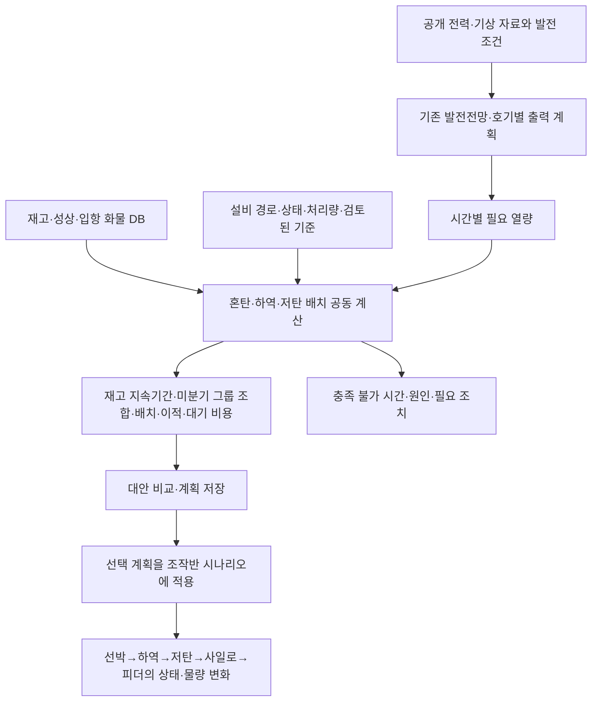

# 발전전망–석탄 수급·혼탄·배치 통합 구현 계획

> 실행 담당자는 `superpowers:executing-plans`로 아래 순서대로 수행한다. 이 문서는 코드 확인에 근거한 설계·구현 계획이며, 구현·배포 완료 보고가 아니다. 커밋·push·공용 서버 반영은 별도 승인 범위를 따른다.

**Goal:** 기존 발전전망을 출발점으로 재고 지속기간, 미분기 그룹별 혼탄, 입항선 하역·저탄 배치, 이적·대기 비용을 함께 비교하고 저장하는 업무 시스템을 만든다.

**Architecture:** 기존 LightGBM 발전전망과 발전기 운전계획 계산을 유지한다. 동일한 입력 버전과 기준시각을 사용하는 연료 수급 계산 및 시간대별 혼탄·물류 최적화를 연결한다. 화면·3D·조작반은 같은 DB와 계산 결과를 읽으며 실제 자료와 조작 시나리오의 상태를 섞어 쓰지 않는다.

**Tech Stack:** 기존 React/TypeScript, Python/FastAPI, SQLite, LightGBM, SciPy/HiGHS, WebSocket 조작반을 사용한다. 이 계획만으로 새 의존성을 추가하지 않는다.

**Spec:** 아래 ‘제품 범위’가 이번 합의의 기준이다. 저장소의 `SPEC.md`, `docs/DATA_DICTIONARY.md`, `AGENTS.md`와 함께 읽되, 기존 SPEC의 초기 화면 구성과 이번 사용자 요구의 차이를 구분한다.

## 제품 범위

- 목적은 급전·발전 전망에 필요한 석탄을 확보하고 적절하게 배치·혼탄하는 의사결정 지원이다. 계약·회계 ERP 전체를 만들지 않는다.
- KPX·AIS 등 공개 자료는 실제 공개 자료로 사용할 수 있다. 선박 식별·위치와 그 배에 부여한 가상의 석탄 화물을 별도 출처로 관리한다.
- 저탄장·성상·운전정보는 해커톤에서 편집 가능한 가상 운영 DB로 구성한다. 기존 사내 자료는 구조 이해용이며 수치·설비 식별정보를 제출물에 복제하지 않는다.
- 상탄은 호기별 A–F 설비와 가동 조합을 설정할 수 있어야 한다. A–E 가동, ABC/DE 또는 AB/CDE 그룹은 초기 사용 시나리오이며 고정 제약이 아니다.
- 그룹별 혼탄은 발열량과 성상 제한, 접근 가능한 재고, 설비 상태, 저장기간, 날씨에 따른 취급 조건을 함께 고려한다.
- 입항선의 배치는 해당 시점의 여유 공간, 고·저열량탄 구성, 이후 필요한 혼탄과 이적, 하역·대기 비용까지 고려한다. 고·저열량 목표 비율은 사용자가 설정하며 임의의 보편적 비율을 넣지 않는다.
- 모드 안내는 공통 상단에서 한 번 표시한다. 출처·세부 자료 구분은 데이터 연결관리에서 확인한다. 업무 화면마다 ‘모의·시연·합성’을 반복하거나 ‘사진’이라는 설명을 넣지 않는다.
- 기존 발전전망의 필요한 그래프·입력·결과·내보내기를 새 디자인 안에서 보존한다.

## Global Constraints

- 공용 Python/API는 ZGX다. 개발·검증은 격리 DB에서 하며 공용 DB에 테스트 자료를 쓰지 않는다.
- `plant_id`, `stockpile_id`, `destination_plant_id`, 단위 `t`, `kcal/kg`, 시간 `KST`를 유지한다. 조회 기간·기준시각·자료 발행시각은 분리한다.
- 실제 재고의 하역 완료 반영 계약을 유지한다. 계획상 하역 진행 물량과 확정 재고를 같은 값으로 취급하지 않는다.
- 미연결·누락·조회 실패는 0 또는 임의 값으로 대체하지 않는다. 최초 로딩과 조회 완료 후 자료 없음도 구분한다.
- 재고·열량 계산은 백엔드 공통 엔진이 담당한다. 화면별 계산 엔진이나 별도 가상 재고를 중복 구현하지 않는다.
- 항차번호는 연도–부두–일련번호다. 번호 없는 배선도 저장할 수 있으며 기존 번호와 충돌하지 않아야 한다.
- 성상 대표값은 하역 분석 우선, 없으면 선적 분석이다. 바이어 샘플 및 각 분석 이력을 보관한다. NCV 기준은 아직 확인되지 않았으므로 ARB HHV와 임의 호환하지 않는다.
- 현재 작업 트리의 다른 변경을 보존한다. 승인된 순서로 구현하되 공용 DB 반영과 이력 정리는 격리 검증 후 배포 절차를 따른다.

## Review Focus

1. 입항·하역·재고 기준시각이 다른 자료의 재수신: 중복 입고나 소진이 없어야 한다. Task 3에서 검증한다.
2. 계산 중 재고·성상·설비가 수정됨: 저장된 결과의 입력 버전을 유지하고 재계산 필요를 표시한다. Task 6에서 검증한다.
3. 미등록 성상, 발열량 기준 불일치, 미연결 설비: 안전·실행 가능으로 단정하지 않는다. Task 4에서 검증한다.
4. 병렬 발전계획 구간 경계와 계산 시간 제한: 가능한 해와 검증된 최적해를 구분한다. Task 2에서 검증한다.
5. 개별 경로는 가능하지만 같은 컨베이어를 동시에 사용: 공유 처리량을 초과한 계획을 추천하지 않는다. Task 5에서 검증한다.

## 1. 기존 모델 확인 결과

확인 대상은 현재 로컬 작업 트리다. 아래는 코드·저장 메타데이터 확인 결과이며 ZGX의 현재 실행 버전이나 예측 정확도를 검증했다는 뜻이 아니다.

| 구성 | 현재 입력·계산 | 현재 출력과 한계 | 코드 근거 |
|---|---|---|---|
| 전력수요 전망 | 시간·요일·휴일·계절·기온 특성으로 LightGBM 총수요 예측. 태양광 프로파일과 증감 가정으로 순수요 산출 | 미래 기온은 평년 또는 과거 연도 조건. 미래 실제 급전 지시를 아는 모델이 아님 | `backend/src/midterm/net_demand.py` |
| 전국 석탄 발전 전망 | 순수요, 원전 공급, 기준 곡선과 LightGBM 잔차, 월별 보정 | 전국 석탄 목표. 선박·탄종·저탄 위치를 직접 예측하지 않음 | `backend/src/midterm/coal_curve.py`, `annual.py` |
| 발전기 운전계획 | 발전기 최소·최대 출력, 기동·정지, 최소 운전·정지 시간, 출력 변화, 정비, 비용·예비력 가정 | 호기별 시간별 MW·가동·기동·비용·부족/초과. 입력 가능한 날짜 범위로 계산하며 기본 시나리오는 연간 | `scenario.py`, `uc.py`, `headroom_uc.py`, `rolling.py` |
| 발전→연료 | 출력별 열소비 곡선 또는 설정 열소비율, 기준 발열량 | 시간·일·월 연료량. 구매 기준 발열량에 의한 양과 재고 혼합 발열량에 의한 양을 구분해야 함 | `fuel_calendar.py`, `supply.py` |
| 수급 전망 | 기준재고, 입하, 이적, 발전에 따른 소비 | 그룹별 시간대 재고·부족 전망은 이미 있음. 로트·미분기 조합·물류의 공동 최적화는 아님 | `supply.py`, `web/planning_api.py` |
| 혼탄 추천 | 사용 가능한 로트의 물량, AR 기준 발열량·총수분·황분, 목표·상한 | 선형계획으로 단발 배합 산출. 시간별 미분기 그룹, 고장 경로, 이적·체선료는 함께 최적화하지 않음 | `blend_recommendation.py` |
| 반입 검토·저장 | 입항일·물량·공간·저장기간·일 사용량·경로 입력 | 입력값 비교 및 저장은 있음. 전체 계획을 다시 풀어 최적 위치를 정하는 기능과는 다름 | `receipt_plans.py`, `src/features/operations/workspace-review.ts` |
| 운전 조작반 | 설비 상태·유량, 사일로, 피더 설정과 시간 재생 | 사일로 증감·피더 배출 기반은 있음. 탄종별 조성, 발전 열수지, 전체 경로 운송 지연까지 연결한 엔진은 아님 | `scripts/fuel-demo/demo-engine.cjs`, `simulation-store.cjs` |

### 로컬 모델 메타데이터

- `backend/models/net-demand.json`: 학습기간 2023-09-01~2026-10-03, 1,124일.
- `backend/models/coal-curve.json`: 학습기간 2026-01-01~2026-09-29, 6,504행·271일. 연중 모든 계절의 성능이 입증된 것으로 해석하지 않는다.
- 현재 발전계획은 48시간 창을 풀어 24시간씩 반영하는 구조다. 병렬 구간 사이의 연결은 `global_segment_seams_certified=False`이며, 구간 내부 검증과 전체 기간 연속 실행 가능성을 구분해야 한다.
- 전국 석탄 목표를 가용 최대 출력의 97%로 제한하는 처리가 있다. 이것을 다른 발전원의 공급까지 공동 최적화한 결과로 표시하면 안 된다.
- 화면의 7/30/60/90일 선택은 저장된 결과 조회 창이다. 발전 모델 자체가 최대 90일만 계산한다는 뜻이 아니다.
- 하루전·신뢰도 발전계획이 이 모델의 필수 직접 입력이라고 확인된 것은 아니다. 공개 API의 실제 항목·발행시각·공간 해상도를 확인한 후 단기 비교·갱신 입력으로 연결한다. 사용자가 추정한 발표 시각을 확정 사양으로 쓰지 않는다.

## 2. 최종 계산 구조

권장안은 **발전전망을 먼저 계산하고, 같은 출력 계획에 대해 혼탄·물류를 공동 계산하는 방식**이다. 모든 발전기와 모든 물류 설비를 처음부터 하나의 거대한 모델로 다시 만드는 방식은 기존 검증 자산과 설명 가능성을 잃기 쉽다. 화면만 연결하는 방식으로는 공유 설비·재고 충돌을 해결할 수 없다.

연료가 부족하면 출력 계획을 몰래 낮추지 않고 ‘어느 시간에 얼마가 부족한지’를 반환한다. 사용자가 출력·입항·혼탄 조건을 바꾼 대안을 별도로 계산한다. 단기에는 시간대별 작업 가능성을 검증하고, 중장기에는 일별로 집계해 보여준다. 집계 화면이라고 설비 동시 사용 충돌을 무시하지 않는다.

### 제안하는 공통 계산 계약

아래 명칭은 **신설 제안**이다. 기존 API를 즉시 바꾸는 것이 아니며 구현 전 `docs/DATA_DICTIONARY.md`에 호환 매핑을 남긴다.

- `PlanningContext`: `scenario_id`, `revision`, `as_of`, `start`, `end`, `generation_run_id`, `input_versions`, `criteria_version`.
- `FuelDemand`: `unit_id`, `interval_start`, `interval_end`, `generation_mwh`, `required_heat_gcal`, `quality`.
- `FuelIntegrationResult`: `status`, `input_versions`, `stock_series`, `mill_blends`, `receipt_allocations`, `transfer_schedule`, `cost_breakdown`, `violations`, `solver_metadata`.
- `status`: `feasible` / `infeasible` / `incomplete` / `error`. 최적성 여부·시간 제한·gap은 별도 `solver_metadata`에 둔다.
- `criteria`: 값·단위·분석 기준·적용 설비/탄종·출처·유효기간·검토 상태·제약 종류를 보관한다. 문헌 참고 범위만으로 강제 안전 제한을 활성화하지 않는다.
- 공개 선박 자료의 출처와 가상 화물·설비 조건의 출처는 독립적으로 저장한다. 시나리오 ID와 단순 자료 구분 컬럼은 역할이 다르며 둘 다 필요하다.

## 3. 화면 구성과 보존할 기능

메인 **발전·수급 전망** 안에서 고정된 순서로 `조건 설정 · 전망 결과 · 대안 비교`를 제공한다. 조건 설정은 기간·발전 조건·재고 및 입항 조건을 읽고 수정하며, 결과는 다음 질문에 답한다.

1. 어느 호기에 얼마의 발전이 예상되는가? — 호기별 시간/일/월 출력, 정비, 가용 출력, 부족·초과.
2. 지금 재고로 언제까지 버틸 수 있는가? — 저탄장별 재고 곡선, 고·저열량 구성, 첫 부족 시점, 입하 전후 변화.
3. 어떤 탄을 어떤 그룹에 넣는가? — 호기·미분기 그룹별 탄종, 배합비·t/h, 적용 성상, 경로, 제한 사유.
4. 들어오는 배는 어디에 내리는가? — 부두·하역 시작/종료·Pile·물량·이적 경로, 공간과 소진 전망.
5. 왜 이 안인가? — 기준안 대비 이적량·작업시간·대기시간·비용·충족하지 못한 조건.

항차·화물 / 접안·하역 / 저탄·재고 / 상탄·혼탄은 이 결과를 상세 조회·수정하는 작업 화면이다. 같은 계획 ID와 선택 날짜를 유지한다. 상단 우측 버튼이 하위 메뉴 역할을 대신하지 않게 하고, 새 계획·저장·엑셀 등 행위와 이동 메뉴를 분리한다.

보존 대상: 기존 입력 폼, 시나리오·실행 이력, 시간별 출력, 일·월 합계, 정비 일정, 전국 수요·태양광·원전·석탄 관계, 연료량·비용, 재고 전망, 경고·계산 근거, 내보내기. 기존 화면별 기능을 목록화해 새 위치와 회귀 테스트를 일대일로 연결한 뒤 이전 화면을 제거한다.

### 3.1 업무 중심 메뉴 계층

왼쪽 기본 메뉴는 아래 다섯 개로 고정한다. 상단에 같은 메뉴 분류를 중복 노출하지 않는다. 데이터·설정은 보조 영역으로 분리한다.

| 기본 메뉴 | 고정 하위 메뉴 | 이곳에서 하는 일 |
|---|---|---|
| 발전·수급 전망 — 첫 화면 | 조건 설정 · 전망 결과 · 대안 비교 | 기간과 변경 조건 선택, 계산 실행, 부족 시점·조합·배치 비교, 계획 저장 |
| 항차·화물 | 선박 추적 · 입항 계획 · 화물·성상 | 관심 선박과 입항 화물 연결, 도착 일정·물량·탄종 관리, 분석 입력 |
| 접안·하역 | 부두 현황 · 하역 계획·기록 | 부두별 선박·경로·작업 확인, 하역 배정과 실제 반입 기록 |
| 저탄·재고 | 저탄장 현황 · 재고·이적 기록 | 도면과 로트 재고 확인, 초기 재고 입력·정정, 이적 입력 |
| 상탄·혼탄 | 혼탄 계획 · 호기 상세 | 그룹별 조합 검토, 사일로·피더·미분기 상태 및 공급 경로 확인 |

- `운영 개요`와 `통합 시뮬레이션`은 발전·수급 전망으로 통합한다. `시나리오 분석`은 대안 비교에 포함하고, 별도의 계산 입력·저장 체계를 만들지 않는다.
- `구매 검토`는 전망 결과의 부족 물량·필요 도착 시점에서 입항 계획을 추가하는 흐름으로 통합한다. 계약 관리 페이지로 확장하지 않는다.
- `발전기 정지계획`은 전망 조건의 정비 일정 편집으로, `계획·실적 분석`은 대응 실적이 있을 때 전망 결과의 비교 기능으로 통합한다.
- `호기·연소`는 상탄·혼탄의 호기 상세로 통합한다. 기존 상세 정보는 보존하되 최상위 메뉴를 중복시키지 않는다.
- `재고 원장`은 저탄·재고에 포함한다. `수급 원장`의 전망·위험 정보는 발전·수급 전망에, 초기 재고·이적 수정은 저탄·재고에, 하역 입력은 접안·하역에 배치한다. 페이지를 없애면서 수정 기능까지 없애지 않는다.
- 선박 기본정보는 항차·화물의 선택·편집 과정에서 관리한다. 매번 별도 선박 관리 화면을 거치게 하지 않는다.
- 데이터·설정에는 연결관리, 운전 조작반, 공통 설비·기준 설정, 사용자 관리와 고급 모델 설정을 둔다. 모델 구현 용어와 JSON 입출력은 일상 업무의 필수 경로에서 제외한다.
- 제목 아래 같은 자리에 하위 메뉴를 유지한다. 우측 버튼은 등록·저장·실행·내보내기 등 행위만 담당한다. 현재 위치는 미들닷으로 연결하고 선택 계획·발전소·조회 시각을 화면 이동 중 유지한다.
- 이전 URL은 기능에 맞는 새 위치로 연결한다. 기존 화면의 입력·계산·조회·내보내기 대응표와 검증이 끝난 기능부터 기존 진입점을 제거한다.

### 3.2 최소 입력 원칙과 이번 범위

사용자에게 DB의 모든 컬럼을 채우도록 요구하지 않는다. **연결된 값은 읽고, 저장된 기준은 재사용하고, 이번 계획에서 바꿀 조건만 입력한다.** 기존 입력 기능 보존은 모든 필드를 기본 화면에 계속 노출한다는 뜻이 아니다.

| 업무 | 사용자가 처음 확인·입력할 것 | 자동 연결·재사용할 것 | 필요할 때만 열 것 |
|---|---|---|---|
| 발전·수급 전망 | 전망 기간, 적용 조건 확인 | 최근 저장 조건, 기준재고·입항 계획·성상·설비 상태, 기존 발전전망 모델 | 수요·기상 가정 변경, 정비 일정, 비용·계산 상세 조건 |
| 입항 계획 | 선박 선택, 예상 도착일, 탄종·물량 | 관심 선박의 식별정보·관측 위치, 연결된 화물, 부두별 다음 항차번호 | 부두 지정, 일정 보정, 대기 비용 조건 |
| 화물·성상 | 연결 화물 선택, 해당 분석 결과 입력·가져오기 | 배선의 탄종·물량·산지, 선박 정보, 기존 분석 및 대표 성상 선택 | 추가 분석 항목, 분석 이력·기준 설명 |
| 저탄·재고 | 초기 설정 또는 변경 시 위치·탄종·물량 | 기준재고 이후 확정 입하·이적·소비 기록 | 구간 치수, 정정 사유와 이력 |
| 상탄·혼탄 | 대상 호기·기간, 적용할 조합 확인 | 발전 필요 열량, 가용 재고·성상·경로, 저장된 그룹 구성·검토 기준 | 그룹 변경, 목표 발열량·제한값의 시나리오별 변경 |

- 처음 진입할 때 전체 폼을 빈칸으로 보여주지 않는다. 저장된 DB와 조건을 불러온 뒤 부족한 정보만 해당 위치에서 보완한다. 계획명은 기간·버전으로 자동 생성하고 이름 변경은 선택 사항이다.
- 항차·화물·저탄·혼탄 화면에서 같은 값을 반복 입력하지 않는다. 연결된 값의 원본 편집 위치를 하나로 정하고, 다른 화면에는 값과 해당 편집 진입점만 제공한다.
- AIS의 목적지·ETA는 관측값이다. 확정된 도착 일정처럼 자동 저장하지 않으며 계획값이 없을 때 참고 후보와 관측 시각을 제공한다. 공개 AIS에서 알 수 없는 적재 석탄은 별도 화물 DB에서 정의한다.
- LAYCAN, Incoterms, 용선 종류, 계약번호·계약일, 노미네이션, 공급계약 행정 정보는 이번 기본 입력·필수 검증·기본 엑셀 양식에서 제외한다. 기존 저장값과 API 호환성은 유지한다.
- 선박코드·내부 ID·자료 구분·revision은 시스템이 관리한다. IMO와 MMSI를 모두 수기로 요구하지 않는다. 번호가 없는 입항 계획 저장도 허용한다.
- 성상 전체 항목을 필수로 만들지 않는다. 활성화한 계산·제약에 필요한 항목만 검사한다. 발열량 기준이나 사용 중인 황분 제한 등 필수 계산 자료가 없으면 해당 계산을 완료할 수 없는 이유와 보완 위치를 보여준다. 미입력 값을 0으로 계산하거나 근거 없는 안전값을 넣지 않는다.
- 고·저열량 비율, 저장기간, 취급 기준, 하역 처리량·비용은 공통 설정을 재사용한다. 매 계산마다 다시 묻지 않으며, 설정이 없으면 해당 평가를 제외했음을 결과의 계산 범위에서 한 번 설명한다. 실행 가능 판정에 필수인 조건은 누락을 해소하기 전 확정하지 않는다.
- 공통 DB 수정과 이번 계획에만 적용하는 변경을 저장 범위로 명시한다. 전망 조건을 바꿔 실행해도 원장·확정 재고가 자동으로 수정되지 않는다.
- 입력 시작 시 필요한 정보의 수집 부담을 줄이되, 설정 없이 계산이 가능한 것처럼 숨기지 않는다. 기본 자료가 준비된 사용자는 **기간 선택 → 조건 확인 → 전망 실행 → 결과 확인**으로 완료할 수 있어야 한다.

검증 기준: 같은 정보 재입력 없음, 행정 항목 없이 계획 저장 가능, 미완성 계획 임시 저장 가능, 연결값 갱신·사용자 보정의 우선순위 유지, 재열기 시 입력 보존, 원장과 계획 변경 범위 구분, 모든 이전 주요 기능의 새 위치 확인.

## 4. 순차 구현 태스크

### Task 1 — 입력 DB와 출처 경계 확정

**Files:** 수정 `backend/src/midterm/stock_baseline.py`, `voyage_registry.py`, `milp_store.py`, `docs/DATA_DICTIONARY.md`; 신설 `backend/src/midterm/fuel_planning_context.py`, `backend/tests/test_fuel_planning_context.py`.

**Interface:** `fuel_planning_context.py`에 위 공통 계약의 `PlanningContext`, `FuelDemand`, `FuelIntegrationResult` 타입을 정의한다. `load_planning_context(scenario_id: str, revision: int) -> PlanningContext`는 기준시각과 발전·재고·성상·설비 입력 버전을 고정한다.

- [ ] 현재 DB·시드·소스·3D 자산·내보내기·백업에서 사내 기준 자료의 잔존 위치를 조사하고 교체 대상 목록과 영향 범위를 작성한다. 사용자 첨부 이미지는 저장소로 복사하지 않는다.
- [ ] 격리 DB에 `test_source_boundaries_and_revision_snapshot` 작성: 공개 AIS를 연결한 가상 화물은 선박 출처를 바꾸지 않으며, 같은 revision 조회는 이후 편집에 영향을 받지 않아야 한다. 먼저 실패를 확인한다.
- [ ] 편집 가능한 시나리오·초기 재고·탄종/분석·설비 경로·성능 조건을 기존 DB에 호환 확장하고 위 인터페이스를 구현한다. 이력 데이터 삭제는 목록·백업·교체 결과를 확인한 뒤 별도 배포 단계에서 처리한다.
- [ ] `backend`에서 `python -m pytest tests/test_fuel_planning_context.py tests/test_stock_baseline.py tests/test_voyage_registry.py` 실행. 모든 테스트 통과 및 기존 ID·수량 계약 유지가 완료 조건이다.

### Task 2 — 발전·수급 전망 메인과 기존 모델 연결 완성

**Files:** 수정 `src/components/PlanningWorkspace.tsx`, `src/features/data/PlanningInputForm.tsx`, `src/features/plant/ForecastFocus.tsx`, `src/domain/planning.ts`, `backend/src/midterm/web/planning_api.py`, `annual.py`, `rolling.py`; 테스트 `tests/planning.test.ts`, `backend/tests/test_annual_headroom.py`, `backend/tests/test_planning_persistence.py`.

**Interface:** 기존 저장·실행·snapshot API를 유지하고 결과에 입력 버전과 검증 범위를 전달한다. `generation_run_id`가 뒤 단계의 고정 입력이다.

- [ ] 기존 화면 기능→새 화면 위치→검증 항목 표를 작성한다. JSON 업로드는 고급 가져오기로 남기고 기본 실행은 기존 입력 폼으로 끝나게 한다.
- [ ] 3.1의 메뉴 대응과 3.2의 입력 범위를 적용한다. 입력 필드마다 자동 연결·공통 설정·계획 변경·고급·범위 제외를 분류하고, 기본 폼과 기본 엑셀의 필수 검증을 같은 기준으로 맞춘다.
- [ ] 실행 이력 재열기, 조회 기간 경계, 미완료 실행, 시간 제한 해, 병렬 구간 경계의 출력 변화·최소 가동/정지 위반을 재현하는 테스트를 추가하고 실패를 확인한다.
- [ ] 조건 설정·전망 결과·대안 비교의 고정 메뉴와 전체 계산 흐름을 연결한다. 예측 MW와 기간 합계 MWh를 구분하고 누락 연료량을 0으로 표시하지 않는다.
- [ ] 병렬 구간의 연속성 검사 및 실패 시 연속 재계산 경로를 구현한다. 검증되지 않은 결과를 실행 가능한 계획으로 승격하지 않는다. 학습기간 밖 계절의 정확도는 공개 실적을 사용한 시간 순서 분리 평가로 별도 제시한다.
- [ ] `python -m pytest tests/test_annual_headroom.py tests/test_planning_persistence.py`와 프런트 전체 필수 검증을 실행한다. 기존 결과 조회·폼 실행·재열기·그래프 보존이 완료 조건이다.

### Task 3 — 출력·열량·로트 재고의 단일 수지 연결

**Files:** 수정 `backend/src/midterm/fuel_calendar.py`, `supply.py`, `stock_inventory.py`; 신설 `backend/src/midterm/fuel_balance.py`, `backend/tests/test_fuel_balance.py`; 테스트 `test_fuel_calendar.py`, `test_stock_inventory.py`, `test_supply.py`.

**Interface:** `build_fuel_demand(context: PlanningContext) -> list[FuelDemand]`, `project_fuel_balance(context: PlanningContext, schedule: dict) -> dict`. 계획 계산은 확정 원장을 수정하지 않는다.

- [ ] `test_heat_to_mass_and_event_idempotency` 작성: 명시적으로 동일 기준인 100 MWh·2,000 kcal/kWh·5,000 kcal/kg 입력은 40 t이며, 같은 입고 이벤트를 두 번 전달해도 한 번만 반영된다. 단위·기준 누락은 `incomplete`여야 한다. 실패를 확인한다.
- [ ] 기존 열소비 계산을 재사용하고 성상 기준을 명시한다. 기준 발열량 연료량과 선택 혼탄 연료량을 별도 값으로 반환한다. NCV 미정 자료를 자동 변환하지 않는다.
- [ ] 재고→사일로 이동과 피더를 통한 최종 소비를 별도 이벤트로 처리해 이중 차감을 막는다. 기준시각 이전 입고, 부분 하역, 완료 처리, 정정, 취소, 재전송을 원장 revision과 이벤트 ID로 검증한다.
- [ ] 위 네 Python 테스트 파일을 실행한다. 전체 물량 수지와 시점별 합계가 일치하고 누락이 전파되는 것이 완료 조건이다.

### Task 4 — 미분기 그룹별 혼탄과 기준 관리

**Files:** 수정 `backend/src/midterm/blend_recommendation.py`, `src/domain/blend.ts`, `src/features/stockyard/OperationsBlend.tsx`; 신설 `backend/src/midterm/coal_criteria.py`, `mill_blend.py`, `backend/tests/test_mill_blend.py`, `test_coal_criteria.py`.

**Interface:** `resolve_coal_criteria(context: PlanningContext) -> dict`, `solve_mill_blends(context: PlanningContext, demand: list[FuelDemand]) -> FuelIntegrationResult`.

- [ ] 별도 문헌 조사 결과를 받아 항목별 출처·적용 범위·분석 기준·검토 상태를 기준 DB에 매핑한다. 확인되지 않은 기준은 참고 정보로 두고 안전 판정에 사용하지 않는다.
- [ ] 테스트 추가 후 실패 확인: ABC/DE와 AB/CDE 구성 변경, F 가동 여부 변경, 하역/선적 대표값 선택, ARB/ADB 혼용 거절, 성상 누락, 고장 경로 배제, 검토되지 않은 기준으로 ‘안전’ 판정 금지.
- [ ] 기존 단발 배합 계산을 시간대·호기·그룹별로 확장한다. 배합비, t/h, 열량, 재고 한도, 경로를 동시에 연결한다. HGI·CSN·회융점·막힘·자연발열 및 회성분 계산은 문헌 검토 없이 단순 질량 평균으로 처리하지 않는다.
- [ ] 해당 Python 테스트와 기존 `test_blend_recommendation.py` 실행. 충족 불가 및 자료 부족의 원인을 항목별로 반환하고 사용자가 조건을 수정해 재계산할 수 있어야 한다.

### Task 5 — 혼탄 수요를 반영한 입항·저탄 배치 공동 최적화

**Files:** 수정 `backend/src/midterm/receipt_plans.py`, `web/planning_api.py`; 신설 `backend/src/midterm/fuel_logistics.py`, `backend/tests/test_fuel_logistics.py`; 수정 `src/features/operations/OperationsWorkspaces.tsx`, `workspace-review.ts`.

**Interface:** `solve_fuel_logistics(context: PlanningContext, demand: list[FuelDemand]) -> FuelIntegrationResult`. Task 4의 배합 제약 구성을 재사용하고 하역·배치·이적 변수와 함께 푼다. 초기 혼탄 결과를 고정해 배치만 사후 결정하지 않는다.

- [ ] 테스트 추가 후 실패 확인: 접근 불가 Pile, 같은 CV 동시 초과, 하역 도중 공간 부족, 입항 지연, 저장기간 내 소진 불가, 이적 경로 고장, 후보 전체 불가.
- [ ] 부두·하역기·공유 CV·이적·Pile 용량을 시간 축에 연결한다. 고·저열량 비율과 저장기간, 이후 혼탄에 필요한 접근성을 입력 조건으로 사용한다. 공간은 단순 총톤수뿐 아니라 설정된 구역·적치 제약도 검사한다.
- [ ] 필수 조건 위반을 비용 절감으로 허용하지 않는다. 설정된 체선 조건에 따른 대기 비용과 이적·취급 비용을 동일 단위로 계산하고 구성별로 반환한다. 가격·처리량 미입력은 비용 또는 완료시각 미확정으로 표시한다.
- [ ] `python -m pytest tests/test_fuel_logistics.py tests/test_mill_blend.py` 실행. 대기 비용이 큰 안과 이적이 많은 안을 비교하는 작은 예제를 손계산과 대조한다. ‘최적’ 표시는 solver가 증명한 범위에서만 사용한다.

### Task 6 — 대안 저장·재현·승인된 시나리오 적용

**Files:** 수정 `backend/src/midterm/receipt_plans.py`, `web/planning_api.py`, `src/domain/planning.ts`, `src/components/PlanningWorkspace.tsx`; 신설 `backend/src/midterm/fuel_plan_store.py`, `backend/tests/test_fuel_plan_store.py`.

**Interface:** `save_fuel_plan(context: PlanningContext, result: FuelIntegrationResult, expected_revision: int) -> dict`, `load_fuel_plan(plan_id: str) -> dict`. 계획에는 입력 snapshot·결과·근거·검증 상태를 함께 저장한다.

- [ ] 테스트 추가 후 실패 확인: 저장 후 동일 결과 재열기, 동시 수정 충돌, 입력 버전 변경 감지, 불완전 결과의 실행 거절, 계획 저장만으로 실제 원장 불변.
- [ ] 기준안/대안의 발전량·부족 기간·연료량·비율·이적량·대기·비용을 같은 기간으로 비교하고 재실행 없이 마지막 입력을 복원한다.
- [ ] 적용은 선택한 조작 시나리오에만 한다. 실제 운영정보 연결 시 조회·계획 전달 어댑터를 마련하되 현장 설비 제어는 이 범위에 포함하지 않는다.
- [ ] `python -m pytest tests/test_fuel_plan_store.py tests/test_planning_persistence.py` 및 계획 화면 검증 실행. 저장된 안의 계산 재현과 실제 재고 불변이 완료 조건이다.

### Task 7 — 조작반·3D·업무 화면의 같은 상태 사용

**Files:** 수정 `scripts/fuel-demo/demo-engine.cjs`, `simulation-store.cjs`, `server.cjs`, `src/domain/fuel-demo/types.ts`, `FuelDemoProvider.tsx`, `src/features/stockyard/OperationsYard.tsx`, `OperationsBlend.tsx`; 백엔드 신설 `backend/src/midterm/fuel_simulation.py`, `backend/tests/test_fuel_simulation.py`; 기존 `tests/fuel-demo-*.test.cjs` 확장.

**Interface:** `advance_fuel_scenario(scenario_id: str, expected_revision: int, elapsed_seconds: float) -> dict`. Task 3의 수지를 사용하며 백엔드가 물량 상태의 단일 소유자가 된다. 기존 Node 조작반은 입력·WebSocket 전달·시각 동작을 유지한다.

- [ ] 백엔드와 Node가 같은 물량을 각각 적분하지 않도록 현재 이벤트 매핑을 작성한다. 운송 중 물량도 상태로 보관한다.
- [ ] 테스트 추가 후 실패 확인: 하역기→CV→Pile→사일로→피더의 질량 보존, 병목·정지·고장, 사일로 포화/고갈, 중복 tick, 재접속·재시작, 0 유량의 완료시각 미확정.
- [ ] 계획의 설비 일정과 혼탄 조성을 조작반에 연결한다. 발전출력은 사용자가 지정한 계획과 피더 공급의 관계를 설명할 수 있게 하고 석탄량만으로 임의의 MW를 생성하지 않는다.
- [ ] 모든 화면과 3D가 같은 scenario/revision을 구독하게 한다. 공급 중단으로 계획 열량을 충족하지 못하면 원인을 전달한다. 실제 센서 미연결은 실제 모드에서 미연결로 유지한다.
- [ ] `python -m pytest tests/test_fuel_simulation.py tests/test_fuel_balance.py`와 `node --test tests/fuel-demo-*.test.cjs` 실행. 마지막으로 전체 필수 검증 및 화면 점검을 완료한다.

## 5. 검증·배포 및 완료 정의

- 각 단계는 의미 있는 회귀 테스트를 먼저 추가하고 실패→구현→통과 순서로 수행한다. 위 신설 파일·인터페이스는 계획이며 아직 존재하는 기능으로 설명하지 않는다.
- 코드 단계 완료마다 `npm.cmd test`, `npm.cmd run build`. UI 변경은 `npm.cmd run test:ui`와 해당 화면 확인까지 실행한다. 새 테스트 파일은 실제 테스트 명령에 포함되는지 확인한다.
- Python 테스트는 `backend` 작업 디렉터리에서 실행하며 격리 DB를 사용한다. solver 시간 제한 테스트는 불안정한 실제 경과시간 대신 제어 가능한 fixture로 검증한다.
- UI: 1920×1080 기본 화면, 좁은 화면, 다크 모드, 로딩/빈 결과/오류/자료 부족, 입력 저장·복원, 계획 간 이동을 확인한다. 표의 내부 스크롤과 페이지 레이아웃을 구분한다.
- ZGX 적용 전 마이그레이션 dry-run·백업·복원 검증·데이터 출처 점검을 수행한다. 공유 계약 변경은 통합 리뷰 대상이다. 배포 뒤에는 허가된 조회로 버전·응답을 검증한다.
- 최종 시나리오: 공개 선박을 가상 화물에 연결→발전전망 실행→재고 부족 시점 확인→혼탄/배치 대안 비교→설비 고장과 입항 지연 변경→추천 수정 이유 확인→저장→재열기→조작반 적용. 매번 같은 값을 다시 입력하지 않아야 한다.
- 문헌상 참고 기준을 현장 검증이 끝난 안전 기준이라고 주장하지 않는다. ‘업무 의사결정 지원 구현 완료’와 ‘현장 안전성 승인’은 별개다.

## 6. 별도 조사와 남은 확인

상탄·혼탄 특성별 문헌 조사는 별도 채팅 `01a1ba39-1232-7532-a370-e0c2cdc300ef`에서 진행 중이다. 결과는 Task 4의 기준 카탈로그에 반영하며 장치별 제한과 일반적인 문헌 지표를 분리한다.

사용자가 추가로 정해야 할 값은 초기 실행 시 편집 가능한 조건으로 받는다: 호기별 그룹 구성, 목표 발열량의 분석 기준, 고·저열량 비율, 제한 성상, 허용 저장기간, 설비 처리량·정지 조건, 체선료 단가 및 적용 조건. 문헌으로 결정할 수 없는 운영 선택을 논문에서 찾은 보편적 정답처럼 넣지 않는다.

현재 문서 작성 단계에서는 코드·DB·서버를 변경하지 않았다. 로컬 모델의 실행 성공·정확도나 공용 서버 버전 일치를 이번 조사만으로 확정하지 않는다. 다음 실행 순서는 Task 1→Task 2이며, 발전·수급 전망 메인의 입력·결과 연결을 먼저 완성한다.
