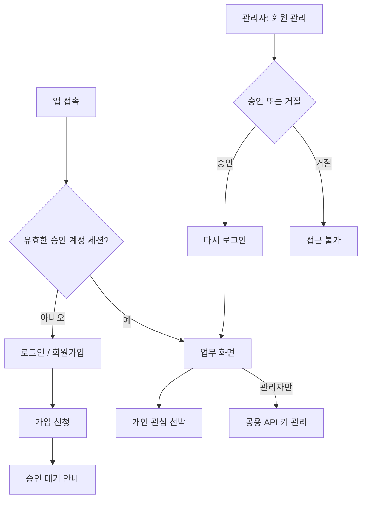

# 회원가입·관리자 승인·공용 API 키 관리 설계

- 작성일: 2026-10-11 KST
- 상태: 2026-10-11 사용자 지시에 따라 가입·승인·계정별 관심 목록 구현 중. 공용 API 키 암호화 저장·교체 UI는 후속 단계이며 이 설계 전체가 완료된 것은 아니다.
- 작업 브랜치: `fix/vessels-route-gap` (사용자가 확인한 현재 작업 브랜치에서 이어서 진행).
- 초기 설정: [회원가입·관리자 승인 설정](../../ACCESS_SETUP.md).
- 기준: `origin/main`의 `3e1b258` (선박 PR #7 병합 완료).
- 관련 문서: [제품 스펙](../../../SPEC.md), [데이터 계약](../../DATA_DICTIONARY.md), [협업 규칙](../../../CONTRIBUTING.md), [선박 API](../../VESSEL_API.md).

## 1. 사용자와 합의한 목표

회원가입 신청은 누구나 할 수 있지만, 관리자가 승인한 계정만 온라인 앱과 업무 API를 이용한다. 관리자는 앱 전용 계정·비밀번호로 로그인한다. 외부 API 키는 관리자가 등록하는 공용 키를 사용하며, 관심 선박은 사용자별로 관리한다.

첫 버전은 현재 Windows PC에서 사용하고 이후 HP ZGX Nano의 Linux 서버로 이전할 수 있어야 한다. API 키를 매번 PowerShell 환경변수에 입력하지 않아도 서버 재시작 후 연결 설정을 복원한다. 기존 상단바·사이드바 구조, 연보라 테마, 라이트/다크 모드와 반응형을 유지한다.

이 설계는 로그인과 승인, 이 인증을 이용하는 공용 키 관리까지 다룬다. GitHub 로그인, 회사 SSO, 이메일 인증·발송, MFA, 공개 서비스 배포 자동화는 포함하지 않는다. 기존 발전량·재고 계산과 선박 관측/시연 구분은 변경하지 않는다.

## 2. 현재 코드와 영향 범위

| 현재 구현 | 필요한 변경 |
|---|---|
| `src/main.tsx`가 바로 App을 표시 | 로그인 상태를 확인한 후 승인된 사용자에게 App 마운트 |
| `src/features/data/DataPage.tsx`는 표본 데이터 안내 중심 | 데이터 연결·회원 관리·API 연결 영역 구성, 실제 상태에 맞는 안내 |
| FastAPI의 MILP·수급·선박 API에 로그인 검사 없음 | 공통 인증 경계와 관리자/사용자 권한 검사 적용 |
| 관심 목록이 `genforecast.vessel-workspace.v1`에 저장 | 서버 계정별 목록을 원천으로 사용; 기존 브라우저 목록은 선택적으로 가져오기 |
| 브라우저 UUID가 선박 API의 `{owner}` | 서버가 인증한 `user_id`만 허용; 임의 UUID는 권한 근거가 아님 |
| 목적항 선택이 공용 localStorage 키에 저장 | 계정별 관심 선박 설정에 포함 |
| AIS·GFW 키를 환경변수에서 읽음 | 공용 비밀 저장소와 연결 수명 관리 계층 사용 |

App·공통 API 호출·Python 앱 등록·의존성·개인 데이터 계약에 영향이 있다. 통합 담당자 검토 대상이며, 일반 사용자에게 서버 공용 변경 기능을 허용하지 않는 것도 명시적인 접근 정책 변경이다.

## 3. 화면과 사용자 흐름

### 로그인·회원가입

- 한 페이지의 `로그인` / `회원가입` 탭으로 구성한다. 현재 관심 선박 창과 같은 탭·Button 디자인을 재사용한다.
- 로그인: 아이디, 비밀번호, 비밀번호 표시 토글, 로그인 버튼.
- 가입: 이름, 아이디, 비밀번호, 비밀번호 확인. 이메일·전화번호는 수집하지 않는다.
- 입력 규칙: 이름 1~50자, 아이디는 영문 소문자·숫자·점·밑줄·하이픈 3~32자. 아이디 앞뒤 공백 제거 및 소문자 정규화 후 중복 검사. 이름은 본인 인증된 실명이 아니라 신청자가 입력한 표시 이름이다.
- 비밀번호는 8~128자, 공백·유니코드·붙여넣기와 비밀번호 관리자 자동완성을 허용한다. 앞뒤 공백을 임의 제거하거나 길이를 자르지 않는다. 대소문자·특수문자 조합을 강제하지 않는다.
- 신청 직후 “가입 신청이 완료되었습니다. 관리자 승인 후 로그인할 수 있습니다.”를 표시한다. 자동으로 업무 화면을 열지 않는다.
- 이미 사용 중인 아이디에는 사용 불가 안내를 제공하되 해당 계정의 이름·역할·승인 상태는 공개하지 않는다.
- 잘못된 로그인은 아이디 존재 여부와 관계없이 같은 오류를 표시한다. 올바른 비밀번호를 제시한 신청자에게만 승인 대기·거절·정지 상태를 알려 준다.
- 승인 대기 계정의 로그인에는 제한 세션만 발급한다. 본인 상태 확인·로그아웃만 가능하다. 승인되면 제한 세션을 폐기하고 다시 로그인하도록 안내한다.
- 서버 연결 실패는 승인 대기나 비밀번호 오류와 구분한다. 실패했다고 업무 화면이나 합성 모드로 자동 진입하지 않는다.

### 회원 관리

- 관리자에게만 `데이터/관리자 → 회원 관리`를 표시한다. 일반 회원은 데이터 연결 현황을 조회할 수 있다.
- 기본 탭은 `승인 대기`, 나머지는 `사용 중`, `거절·정지`. 이름·아이디 검색과 신청 시각(KST)을 제공한다.
- 승인 시 기본 역할은 일반 사용자다. 관리자는 승인·거절·이용 정지·정지 해제를 할 수 있다.
- 관리자 승격·강등은 별도 동작으로 표시하고 최근 비밀번호 확인을 요구한다. 단순 승인 버튼이 관리자를 만들지 않는다.
- 자기 자신 또는 마지막 활성 관리자의 강등·정지는 허용하지 않는다. 동시에 여러 요청이 와도 DB 트랜잭션에서 마지막 관리자를 보호한다.
- 처음에는 계정 영구 삭제 대신 거절·정지를 사용해 승인 이력을 남긴다.
- 작업 중 버튼만 비활성화하고 결과를 해당 행에 표시한다. 다른 행과 창 크기는 불필요하게 바꾸지 않는다.

### API 연결 관리

- `AISstream`, `GFW`: 미설정/환경변수 사용/암호화 저장/사용 중지, 연결 상태, 마지막 확인·변경 시각 표시.
- 작업: 키 등록·교체, 연결 확인, 삭제(사용 중지). 저장된 키 원문을 다시 보여 주는 기능은 제공하지 않는다.
- 연결 상태는 미설정·연결 확인 중·연결됨·인증 실패·일시적 장애를 구분한다. AIS 연결 후 메시지가 없는 상태를 인증 실패로 단정하지 않는다.
- 신규 입력값은 검증 후 저장한다. 인증 거절이면 기존 키를 유지한다. 네트워크 장애로 검증하지 못하면 저장을 완료했다고 표시하지 않으며 재시도를 제공한다.
- 연결 확인 동안 기존 Thinking Orbs를 해당 상태 행에 표시한다. 반복 작업 중 이중 제출을 막는다.
- Open-Meteo·GDACS·Digitraffic은 키가 필요 없는 현재 공급원임을 표시하고 실제 연결 상태만 조회한다.
- 키나 비밀번호는 입력 제출 후 화면 상태에서 제거한다. URL·브라우저 저장소·분석 이벤트·오류 로그에 넣지 않는다.

## 4. 계정·권한·세션

### 계정 상태

`pending → active` 또는 `pending → rejected`. `active ↔ suspended`. 거절된 계정은 관리자가 대기로 되돌린 뒤 재심사할 수 있다. 아이디 변경과 재가입에 의한 상태 우회는 첫 버전에 제공하지 않는다.

| 동작 | 비로그인 | 승인 대기 등 제한 세션 | 일반 사용자 | 관리자 |
|---|---|---|---|---|
| 로그인·가입 | 허용 | 로그아웃 후 이용 | 해당 없음 | 해당 없음 |
| 자기 세션·상태 확인, 로그아웃 | 세션 없음을 반환 | 허용 | 허용 | 허용 |
| 온라인 업무 화면·AIS·기상·기항·저장 MILP 조회 | 차단 | 차단 | 허용 | 허용 |
| 자기 관심 선박·목적항·개인 시나리오 변경 | 차단 | 차단 | 허용 | 허용 |
| 다른 사용자의 개인 관심 목록 | 차단 | 차단 | 차단 | 일반 화면에서는 차단 |
| 사용자 승인·역할 변경·공용 API 키 관리 | 차단 | 차단 | 차단 | 허용 |
| 수급 원장·공용 설정 변경·서버 계산 실행 | 차단 | 차단 | 차단 | 허용 |

브라우저에서만 계산하는 개인 시연과 서버 공용 원장 변경을 구분한다. 일반 사용자가 할 수 없는 저장·실행 버튼에는 권한 안내를 표시하며 서버도 동일하게 거절한다.

### 최초 관리자·복구

- 서버 컴퓨터에서 실행하는 `python -m midterm admin init`(구현할 명령)으로 최초 관리자 계정을 만든다. 아이디·이름·비밀번호를 대화형으로 입력하고 비밀번호는 숨김 처리한다.
- 관리자 미설정 상태에서는 업무 API를 열지 않는다. 공용 웹 가입으로 첫 관리자를 생성하지 않는다. 초기화 명령은 계정 DB 트랜잭션으로 중복 초기화를 방지한다.
- 관리자 추가는 기존 관리자의 명시적 승격으로 처리한다. 코드·DB에 기본 비밀번호를 넣지 않는다.
- 이메일 없이 비밀번호를 잊은 경우 서버 운영자가 `python -m midterm admin reset-password`(구현할 명령)로 해당 아이디의 임시 비밀번호를 설정한다. 명령행 인자에 비밀번호를 쓰지 않는다. 모든 기존 세션을 폐기하며 다음 로그인에서는 비밀번호 변경만 허용한 후 새 세션을 발급한다. 거절·정지 상태는 복구 명령으로 해제되지 않는다.
- 로그인한 사용자의 비밀번호 변경도 현재 비밀번호 확인과 전체 세션 폐기를 거친다.

### 저장과 세션 정책

- 비밀번호: 유지보수되는 라이브러리의 Argon2id 해시. 최소 메모리 19 MiB, 반복 2, 병렬도 1 이상에서 서버 성능을 확인한다. 해시 버전을 기록하고 필요할 때 로그인 과정에서 갱신한다.
- 세션: 예측할 수 없는 256비트 이상 토큰. 브라우저는 HttpOnly 쿠키로 보관하며 서버 DB에는 토큰 해시만 저장한다. JWT/localStorage 로그인 토큰은 사용하지 않는다.
- 기본 만료: 로그인 후 최대 12시간, 미사용 60분. 제한 세션은 최대 30분. 키·관리자 역할 변경에는 최근 5분 내 재인증이 필요하다.
- 승인·거절·정지·역할·비밀번호 변경은 계정 버전을 올리고 기존 세션을 폐기한다. 요청마다 계정 상태·버전을 확인한다. 이미 완료된 다운로드를 회수하거나 이미 승인돼 실행 중인 계산을 취소하는 기능은 이 범위가 아니다.
- 로그인·권한 상승 시 토큰을 새로 발급한다. 로그아웃은 서버 세션 폐기와 쿠키 삭제를 함께 수행한다.
- CSRF: 로그인/가입을 포함한 변경 요청에 허용 Origin 검사와 사전 발급 CSRF 토큰 검증을 적용한다. 인증용 공개 endpoint도 예외가 아니다. 쿠키는 SameSite=Lax, Path=/, Domain 미지정이다.
- 로그인 실패는 아이디별 15분당 5회와 IP별 15분당 30회, 가입은 IP별 시간당 10회로 시작한다. 초과 시 429와 재시도 가능 시각을 제공하며 영구 계정 잠금은 하지 않는다. 전달 IP 헤더는 지정된 신뢰 프록시만 인정한다.
- 클라이언트 폴링마다 실패 안내를 쌓지 않는다. 401이면 진행 중 요청·폴링·계정 상태를 정리하고 로그인으로, 403이면 계정 상태 또는 권한 안내로 전환한다. 인증 오류를 데이터 없음이나 합성 fallback으로 삼지 않는다.

## 5. 서버에서 보호하는 범위

허용 목록에 있는 로그인·가입·CSRF 준비·최소 서비스 상태 endpoint 외에는 기본적으로 인증이 필요하다. HTML 셸·일반 CSS/JS/아이콘은 공개할 수 있지만 업무 결과·사용자·키 정보는 담지 않는다. API 문서(`/docs`, `/redoc`, `/openapi.json`)는 관리자만 접근하거나 배포 시 비활성화한다.

기존 `web/app.py`의 `/api/*`, `supply_api.py`, `planning_api.py`, `vessels_api.py` 전체를 감사한다. 조회처럼 이름 붙은 POST도 일괄 관리자로 막는 대신 목적에 맞게 명시적으로 분류한다. 예: 선박 경로·기상 계산은 승인 사용자, 원장 변경·MILP 실행은 관리자다. 새 미분류 변경 endpoint는 기본 거부한다.

Python에서 제공하는 기존 `/`·`/planning` HTML 업무 화면도 승인 사용자로 제한하고, 내부 편집·실행 요청에는 역할 및 CSRF 검사를 적용한다. Vite 화면만 잠그고 직접 backend URL에서 우회하는 경로를 남기지 않는다. 인증되지 않은 기존 HTML 요청은 앱 로그인으로 안내한다.

`file://` 단일 HTML은 기존 합성 데모에 한해서 유지한다. 오프라인에서는 계정 로그인·실제 API·계정 캐시 접근을 제공하지 않고 합성 시연임을 명시한다. 공개 소스와 이미 번들된 합성 자료는 인증으로 비공개가 되지 않는다. `Origin: null`로 온라인 API를 호출하는 것은 허용하지 않는다.

## 6. 개인 관심 선박과 기존 데이터 이전

- 온라인 관심 목록의 원천은 서버의 `user_id`별 workspace다. 같은 계정이면 다른 PC에서도 목록과 목적항 선택을 볼 수 있다.
- 기존 workspace v1의 선박·관심·개인 항차 DTO를 검증하여 재사용한다. 팀 Voyage/Cargo 원장으로 자동 승격하지 않는다. 목적항 설정은 별도 검증 필드로 포함한다.
- 서버는 로그인에서 결정한 `user_id`를 사용한다. 기존 `/api/vessels/.../{owner}/...`는 `owner == session.user_id`일 때만 허용한다. 클라이언트가 보낸 UUID가 다르면 403이며, 관리자도 이 경로에서 다른 사용자로 위장할 수 없다.
- `GET/PUT /api/me/vessel-workspace`로 목록을 읽고 저장한다. PUT은 버전 번호를 비교해 충돌 시 409로 알려 준다. 마지막 요청이 다른 PC의 변경을 조용히 덮어쓰지 않는다. 첫 GET이 끝나기 전 빈 목록을 자동 저장하지 않는다.
- 저장은 서버 성공 응답 이후 확정 표시한다. 실패하면 미저장 상태와 재시도를 제공하며 기존 서버 목록을 보존한다. 요청 크기는 1 MiB 이하, 관심 선박 한도는 기존 200척을 유지한다.
- 관심 목록 저장 후 서버가 계정별 수집 등록을 갱신한다. 별도 항적 DB 갱신은 재시도 가능한 상태로 관리하고 서버 시작 시 저장 목록에서 재구성한다. 목록 저장 성공과 수집 준비 완료를 구분한다.
- 최초 로그인 시 브라우저의 기존 목록이 있으면 `기존 관심 선박 N척 가져오기` / `나중에`를 표시한다. 서버 목록과 검증 후 병합하고 성공하기 전 원본을 지우지 않는다.
- 기존 익명 owner UUID는 서버 자료의 소유권 증거가 아니므로 로그인 계정에 자동 연결하거나 외부에서 claim하도록 만들지 않는다. 기존 DB의 관측 항적은 보존하고 등록한 공개 선박의 공유 관측 이력으로 활용하되, 익명 사용자의 목록·선호는 노출하지 않는다.
- 서버의 익명 수집 등록은 전환 시 백업 후 비활성화한다. 원본 관측과 메타데이터를 삭제하지 않는다. 활성 승인 계정의 목록 합집합을 수집 대상으로 삼는다.
- 로그아웃·계정 변경 시 메모리의 목록·항로·기상·GFW 응답을 비우고 이전 요청을 취소한다. 이전 계정의 늦은 응답이 새 화면에 들어오지 않도록 세션 세대 값을 검사한다.
- 계정별 서버 목록은 브라우저 localStorage에 영구 복제하지 않는다. 가져오기 전의 기존 익명 자료는 보존하되 자동 로드하지 않는다. `가져옴/나중에` 여부만 계정·기존 자료 버전별로 기록할 수 있다. 공용 PC의 기존 익명 자료에는 소유자 인증이 없다는 점을 가져오기 안내에 명시한다.

## 7. 공용 API 키 암호화·교체

API 키는 공급자에게 원문을 보내야 하므로 비밀번호와 달리 복호화 가능한 인증 암호화를 사용한다. Python `cryptography`의 AES-256-GCM을 사용하고, 저장할 때마다 무작위 nonce를 새로 만든다. 서비스 ID·레코드 버전을 AAD로 묶어 다른 공급자의 암호문으로 바꿔치기할 수 없도록 한다. 자체 암호 알고리즘은 만들지 않는다.

- 계정·키 메타데이터·암호문은 전용 DB `backend/data/access.sqlite3`에 둔다. 공개 승인된 `planning.sqlite3`에 계정이나 키를 넣지 않는다.
- 32바이트 마스터 키는 저장소 밖의 운영체제 사용자 데이터 디렉터리에 둔다. Windows는 서버 실행 계정만 읽도록 ACL을 설정하고 Linux는 전용 서비스 사용자 소유의 0600 파일/0700 디렉터리를 사용한다. 접근 제한을 적용할 수 없으면 초기화를 실패시킨다.
- 환경별 경로는 명시적으로 설정 가능하게 한다. OS 사용자 데이터 디렉터리 생성은 최초 서버 운영자 설정 단계에서 수행한다. 이 설계 문서 작성 중에는 생성하지 않는다.
- 암호문이 있는 상태에서 마스터 키가 없거나 틀리면 명시적인 잠금/복구 오류를 표시한다. 새 키를 자동 생성해 기존 자료를 덮어쓰지 않는다. 로그인은 유지할 수 있으나 외부 키가 필요한 연결은 중지한다.
- 키와 DB를 함께 탈취하거나 서버 실행 계정을 장악하면 이 저장 암호화만으로 보호할 수 없다. 따라서 서버 권한·HTTPS·백업 분리도 적용한다.
- 키 레코드가 없으면 기존 `AISSTREAM_API_KEY` / `GFW_API_TOKEN`을 사용할 수 있다. UI에 환경변수 공급원임을 표시하며 원문을 반환하지 않는다. 등록 후에는 DB 값이 우선한다.
- 키 삭제는 지속적인 `disabled` 레코드를 남기고 연결을 중지한다. 재시작 때 환경변수의 옛 키가 몰래 다시 활성화되지 않는다. 재등록해야 사용을 재개한다.
- 변경은 재인증·CSRF·버전 비교 후 공급자별 잠금으로 직렬 처리한다. 새 키 연결 검증이 실패하면 기존 연결/DB를 유지한다. 검증된 키 저장이 실패해도 기존 연결을 유지한다.
- 저장 성공 후 AIS는 기존 수집 작업을 정상 종료하고 새 키로 한 번만 재연결한다. GFW는 새 클라이언트/설정 버전으로 교체한다. 후속 적용 실패는 `저장됨·적용 재시도 필요`로 구분하고 다음 재시작에도 저장된 버전을 사용한다.
- 키 교체 전 시작한 요청은 그 설정 버전에 묶는다. 키 삭제 후 늦게 도착한 응답은 버리고 신규 요청은 차단한다. 공급자 호출 권한이 바뀌는 GFW 캐시는 키 교체·삭제 시 무효화한다. 수집한 공개 AIS 항적은 키 삭제 때문에 지우지 않는다.
- 응답·로그·감사 이력에는 키 원문·암호문·마스터 키·비밀번호·세션 토큰·요청 본문을 남기지 않는다. 공급자 오류 본문도 안전한 상태 코드와 안내로 정규화한다.

## 8. 데이터와 API 경계

### 전용 저장소

| 엔터티 | 주요 필드 |
|---|---|
| users | user_id(UUID), username_normalized(unique), display_name, password_hash, role, status, auth_version, must_change_password, created_at, reviewed_at, reviewed_by |
| sessions | token_hash, user_id, auth_version, scope(full/pending/password_change), created_at, last_seen_at, expires_at, reauthenticated_at |
| user_workspaces | user_id, revision, validated_payload, destination_preferences, updated_at |
| service_credentials | provider(unique), revision, state(enabled/disabled), ciphertext, nonce, key_version, updated_at, updated_by |
| audit_events | actor_id, action, target_id, result, occurred_at (값/본문 미포함) |

시간은 UTC로 저장·전달하고 화면에서는 기존 KST 표기 규칙을 따른다. DB 스키마 버전과 순차 migration을 두고 업그레이드 전 백업한다. 만료 세션·속도 제한 데이터는 정리하며 감사 이력 기본 보존은 90일이다. 마스터 키는 이 DB에 포함하지 않는다.

### 제안 endpoint

| 경로 | 목적·권한 |
|---|---|
| `GET /api/auth/bootstrap-status` | 초기 관리자 설정 필요 여부만 공개 |
| `GET /api/auth/csrf` | 짧은 수명의 사전 인증/세션 CSRF 준비, no-store |
| `POST /api/auth/register` | 일반 사용자 가입 신청, 항상 pending |
| `POST /api/auth/login` | 비밀번호 검증, 계정 상태에 맞는 세션 발급 |
| `GET /api/auth/session` | 본인 계정 최소 정보·상태·권한 반환 |
| `POST /api/auth/logout` | 서버 세션 폐기 |
| `POST /api/auth/reauthenticate` | 민감 작업용 현재 비밀번호 재확인 |
| `PUT /api/auth/password` | 현재/임시 비밀번호 검증 후 변경·세션 교체 |
| `GET /api/admin/users` | 관리자 목록, 상태 필터·검색·페이지 지원 |
| `POST /api/admin/users/{id}/actions` | approve/reject/suspend/restore/reopen/change-role, 예상 버전 검사 |
| `GET/PUT /api/me/vessel-workspace` | 본인 관심 목록과 설정, 충돌 검사 |
| `GET /api/admin/integrations` | 관리자 설정 메타데이터; 원문 제외 |
| `PUT/DELETE /api/admin/integrations/{provider}/credential` | 관리자 재인증 후 키 교체·사용 중지 |
| `POST /api/admin/integrations/{provider}/test` | 공급자별 제한된 연결 테스트 |
| `GET /api/integrations/status` | 승인 사용자용 비밀 없는 연결 현황 |

미인증 401, 권한/미승인 403, 상태 경합·중복 409, 입력 오류 422, 요청 제한 429를 구분한다. 오류 응답은 안정적인 code와 사용자 안내를 반환하며 내부 예외·비밀을 담지 않는다. 인증·관리 API 응답에는 `Cache-Control: no-store`를 적용한다.

## 9. 개발과 HP 서버 이전

- 로컬은 기존 프런트 5173 → Python 8093 프록시를 유지한다. HTTP 쿠키 예외는 명시적 로컬 개발 설정과 loopback 바인딩에서만 허용한다. `localhost`/`127.0.0.1`을 섞으면 별도 쿠키가 된다는 실행 안내를 제공한다.
- HP 서버에서는 같은 HTTPS origin 아래 프런트와 `/api`를 제공한다. 세션 쿠키 Secure를 활성화하고 Python은 loopback에 바인딩한다. 허용 Host/Origin을 설정하며 외부에서 백엔드 포트로 직접 들어오지 않게 한다. 실제 배포·프록시 구성은 후속 작업이다.
- 인증을 무조건 꺼 주는 운영용 스위치는 만들지 않는다. 자동 테스트는 격리된 DB·임시 관리자·테스트 설정으로 실행한다. 실제 개발 서버의 세션·DB를 테스트가 변경하지 않는다.
- Windows→Linux 이전은 쓰기/수집 중지 → 각 SQLite의 일관된 백업 → 별도 경로로 마스터 키 이전 → 대상 서비스 계정 권한 설정 → 모든 세션 폐기 → 복호화·로그인·연결 확인 순서다. WAL 파일을 무시하고 실행 중 DB 파일만 복사하지 않는다.
- 마스터 키를 분실하면 API 키는 공급자에서 재발급·재등록해야 한다. 비밀번호 해시와 계정 DB가 남아 있으면 계정을 새로 만들 필요는 없다. 기존 암호문을 폐기하는 복구는 서버 운영자의 명시적 명령으로만 한다.
- 개인별 로컬 서버를 계속 쓰는 동안 계정 DB와 API 키는 각각 별개다. 공용 계정·관심 목록을 팀 전체가 공유하려면 동일한 HP 서버에 접속해야 하며 Git clone으로 사용자나 비밀이 배포되지는 않는다.

## 10. 구현 단위·검증 기준

작업은 의존 순서로 나눈다. 이 절은 설계상 경계이며, 구체적인 파일별 구현 계획은 문서 검토 후 별도로 작성한다.

1. 계정 DB·최초 관리자 명령·세션·서버 권한 경계.
2. 로그인·가입·승인 대기·회원 관리 UI와 기존 화면의 역할 반영.
3. 관심 선박 계정별 저장·기존 목록 가져오기·계정 전환 격리.
4. API 키 암호화·관리 UI·실행 중 연결 교체·이전 안내.

주요 위치는 `src/features/auth/`와 `src/features/data/`, 공통 인증 상태·API 요청 도구, `backend/src/midterm/auth/`와 `backend/src/midterm/web/`이다. 계정·암호화 의존성은 필요성을 기록하고 Python manifest/lock을 함께 갱신한다. 기능 폴더끼리 직접 import하지 않고 공통 계약과 App을 통해 연결한다.

완료 판단에 필요한 테스트:

- 가입 시 role/status 조작으로 관리자 또는 활성 사용자가 될 수 없음. 중복 아이디·비밀번호 불일치·잘못된 입력 검증.
- 승인 전 API 직접 호출 거절. 승인 후 재로그인 성공. 거절·정지·강등·비밀번호 변경 후 이전 세션 거절.
- 첫 관리자 중복 초기화와 마지막 관리자 동시 강등 방지. 잘못된 비밀번호/ID 응답, 속도 제한, CSRF·Origin·쿠키·세션 만료 확인.
- 실제 등록된 FastAPI 경로 목록 기준으로 업무 GET과 변경 요청의 권한을 표로 검사. 기존 Python HTML과 다운로드 경로도 포함.
- A/B 두 계정의 관심 목록·목적항·응답·캐시 분리. owner 위조 거절. 기존 목록 가져오기 실패 보존, 중복 가져오기, 다중 PC revision 충돌.
- API 키 암복호화, 잘못된 키·손상 데이터·서비스 AAD 불일치, 키 파일 없음, 재시작 후 복원, 삭제 후 환경변수 재활성화 방지.
- 키 검증/DB 저장/적용 각 단계 실패, 동시 교체, 이전 요청 응답 폐기, AIS 중복 수집 작업 방지, GFW 캐시 무효화.
- 응답·로그·Git 대상에 비밀번호·API 키·세션·암호문이 포함되지 않음. 신규 DB는 기존 공개 자산 검사에 포함되지 않음.
- 로그인/가입/관리 화면의 라이트·다크·모바일·키보드·입력 자동완성, 폼 오류·로딩, 기존 지도·발전소·저탄장 회귀.
- `npm test`, `npm run build`, `npm run test:ui`, Python pytest, 기존 공유 자산 검증, `git diff --check` 수행. 테스트는 인증을 꺼서 기존 실패를 숨기지 않는다.

## 11. 참고와 결정 기록

- 사용자 확정: 관리자 등록 공용 키, 앱 전용 계정·비밀번호, 회원가입 후 관리자 승인, 승인 사용자만 업무 이용.
- 이 문서의 구체화: 아이디 기반 가입, 서버 세션, 최초 관리자 CLI, 비밀번호 복구 CLI, 계정별 workspace, 원장 변경 관리자 제한, 기존 환경변수의 명시적 우선순위.
- 선택 근거: 기존 FastAPI에 통합하면 현재 로컬 사용과 HP 이전을 동일한 코드로 지원할 수 있다. GitHub OAuth는 사용자가 앱 전용 계정을 선택해 제외했다. 브라우저 전용 로그인은 서버 API를 보호하지 못하므로 사용하지 않는다.
- [OWASP Authentication](https://cheatsheetseries.owasp.org/cheatsheets/Authentication_Cheat_Sheet.html)
- [OWASP Password Storage](https://cheatsheetseries.owasp.org/cheatsheets/Password_Storage_Cheat_Sheet.html)
- [OWASP Session Management](https://cheatsheetseries.owasp.org/cheatsheets/Session_Management_Cheat_Sheet.html)
- [OWASP CSRF Prevention](https://cheatsheetseries.owasp.org/cheatsheets/Cross-Site_Request_Forgery_Prevention_Cheat_Sheet.html)
- [OWASP Cryptographic Storage](https://cheatsheetseries.owasp.org/cheatsheets/Cryptographic_Storage_Cheat_Sheet.html)
- [cryptography 인증 암호화 API](https://cryptography.io/en/latest/hazmat/primitives/aead/)

참고 문서는 구현 단계에서 사용하는 라이브러리 공식 문서와 함께 재확인한다. 사용자 DB·마스터 키·실제 자격증명은 Git에 포함하지 않는다. 문서 승인은 제품 구현 완료나 보안 검증 완료를 의미하지 않는다.
